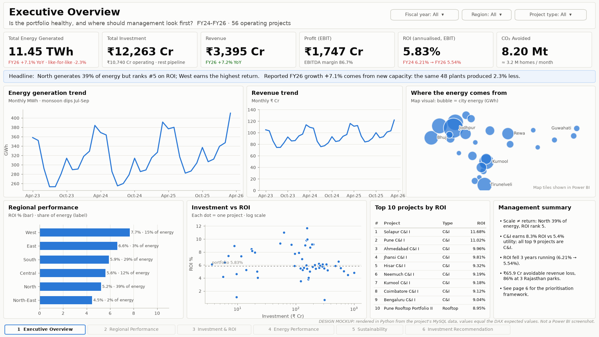
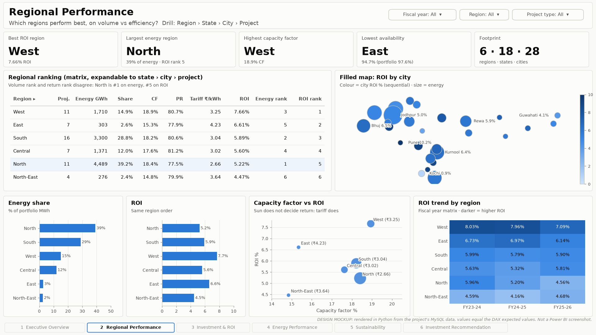
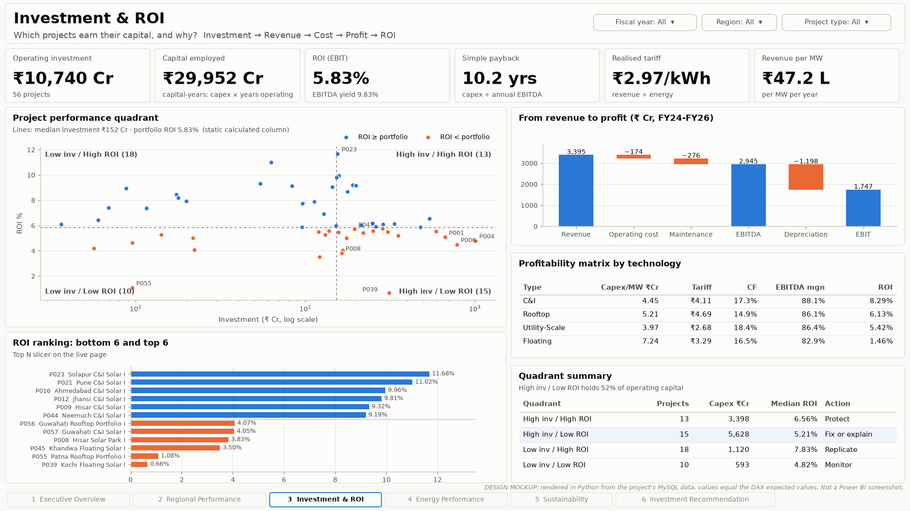
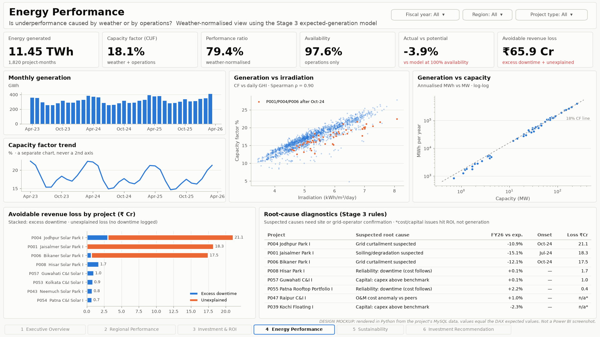
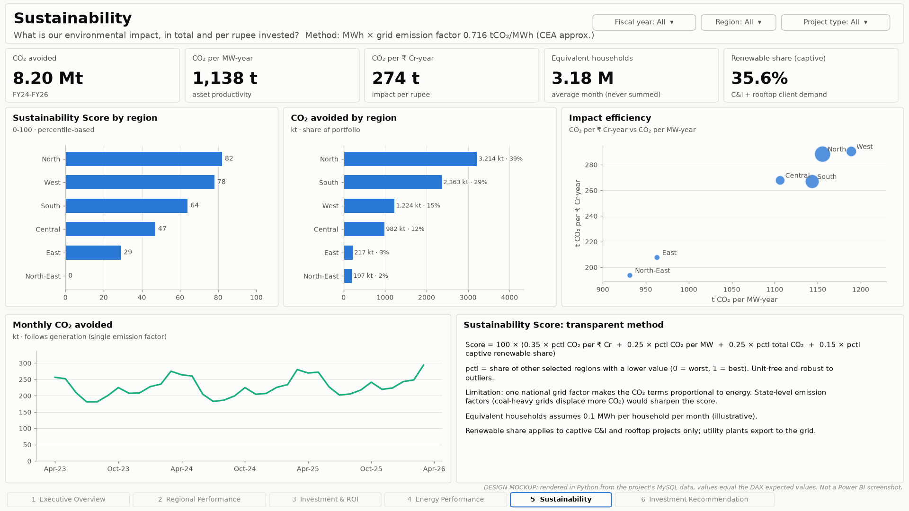

# Solar Energy Data Analysis & Investment Intelligence

**A decision-support analytics system for a (simulated) Indian solar portfolio: MySQL data pipeline → Python diagnostics → Power BI model, 100 DAX measures and a 6-page dashboard → insights and an investment-prioritisation framework.**

    

> **Headline:** North generates **39 % of the energy but ranks 5th of 6 on ROI**. Return follows the **tariff**, not the sunshine: C&I projects earn **8.3 %** vs **5.4 %** for utility-scale despite a lower capacity factor. The board's "+7 % generation growth" is **−2.3 % like-for-like**: the existing fleet is producing less.


<sub>Design mockup rendered in Python from the project data (Power BI Desktop is Windows-only). Values equal the DAX expected values. Not a Power BI screenshot; see [Project status](#project-status).</sub>

---

## Contents
[Business problem](#business-problem) · [Dataset](#dataset) · [Architecture](#architecture) · [Tech stack](#tech-stack) · [Data model](#data-model) · [SQL](#sql-analysis) · [Advanced analytics](#advanced-analytics) · [Dashboard](#power-bi-dashboard) · [Insights](#key-insights) · [Recommendations](#business-recommendations) · [Limitations](#limitations) · [Future work](#future-improvements) · [Reproduce](#how-to-reproduce) · [Repository](#repository-structure)

## Project status

| Area | Status | Evidence |
|---|---|---|
| Synthetic data generator | ✅ Executed | `python/generate_data.py`: physics-based, 67 injected defects, 7 planted scenarios |
| MySQL pipeline (8 scripts) | ✅ Executed on MySQL 8.0.33 | `python/validate_pipeline.py`: **41/41 checks**; totals reconcile to the source exactly |
| Advanced analytics | ✅ Executed | 7/7 planted root causes identified; loss estimates within +4–7 % of the truth |
| Power Query, data model, 100 DAX measures | ✅ Written, ⏳ **not yet executed** | `powerquery/queries.m`, `dax/measures.dax`; expected value for every measure in `powerbi/05_dax_expected_values.md` |
| Power BI report (`.pbix`) | ⏳ To build on Windows | Click-by-click guide plus 6 page mockups in `powerbi/` |

## Business problem

*Arka Renewables* (fictional) operates 56 solar projects, with 4 more under construction: 2,927 MW and ₹12,263 Cr invested across 6 Indian regions. Portfolio ROI has fallen three years running, the board pack reports growing generation, and the Investment Committee must allocate the next capital tranche. Management asked:

1. Which regions perform well, and on which measure?
2. Which projects need investigation, and why?
3. Where should future capital go?
4. Which projects generate the highest returns?
5. Which deliver the greatest sustainability impact?

→ [Full business case, 17 insights and recommendations](documentation/04_business_case_and_insights.md)

## Dataset

No public dataset combines plant-level generation, capex, tariffs and O&M cost, so the data is **synthetic but physics-based**:

```
energy = capacity × irradiation × plane-of-array gain × performance ratio × temperature loss × degradation × availability × hidden losses
```

| | |
|---|---|
| Scope | 60 projects · 28 cities · 18 states · 6 regions · Apr-2023 to Mar-2026 (Indian FY) |
| Facts | Energy, financials and sustainability: 1,820 project-months each |
| Benchmarks | Capacity factor 14.9–18.4 % by technology; capex ₹4.0–7.2 Cr/MW; tariffs ₹2.4–5.4/kWh |
| Planted scenarios | Soiling, grid curtailment (2), inverter failures, hailstorm, O&M overrun, capex overrun |
| Injected defects | 67: duplicates, sign errors, unit errors, ×10 spikes, NULLs, invalid dates, orphans, text variants |

Ground truth sits in `data/ground_truth/`. **The pipeline never reads it;** only the validation scripts do. → [Design document](documentation/01_project_design.md)

## Architecture

```
Raw CSV exports (SCADA, ERP, asset register, client meters)
   │  LOAD DATA (all-text staging)
   ▼
MySQL ─ stg_* ─► DQ checks + dq_issue_log ─► star schema (dim_*, fact_*) ─► vw_* KPI views
   │                                                          │
   │                                     Python: expected-generation model,
   │                                     anomalies, Pareto/ABC ─► ana_* tables
   ▼
Power BI ─ thin Power Query ─► star model ─► 100 DAX measures ─► 6 pages
   ▼
Insights (fact vs interpretation) ─► Investment Priority Score (framework, not advice)
```

Key decisions: cleaning happens in **SQL, not Power Query** (versioned, testable, keeps folding). The **billing meter is the system of record**, so SCADA readings are reconciled against revenue ÷ tariff. **Profit is a generated column**, and **ROI is time-weighted**.

## Tech stack

| Tool | Used for |
|---|---|
| **MySQL 8.0** | Staging, validation functions, constraints, star schema, views, 19 analytical queries |
| **SQL** | CTEs, window functions, ROLLUP + GROUPING, stored functions, generated columns |
| **Python** (pandas, NumPy, SQLAlchemy, matplotlib) | Data generation, validation, regression model, anomaly detection, scoring reference, charts |
| **Power Query (M)** | Parameterised connection, fiscal date table, 1:1 merges, validation and error-audit queries |
| **Power BI / DAX** | Star model, 100 measures (time intelligence, ranking, scores, narrative), 6-page design |

## Data model

```
              Date (daily, FY Apr–Mar)
                     │ 1
     ┌─────────┬─────┴──────┬──────────────┐
     * Energy  * Financials * Sustainability * Month Diagnostics    (project × month)
     └─────────┴─────┬──────┴──────────────┘
                     │ 1
          Project (flattened: region › state › city › project)
```

Two dimensions, four facts, eight one-to-many single-direction relationships. Investment lives on the dimension, never on the monthly rows. → [Data model](powerbi/01_data_model.md)

## SQL analysis

| Script | What it shows |
|---|---|
| [`05_data_quality_checks.sql`](sql/05_data_quality_checks.sql) | Strict date parser (MySQL's `STR_TO_DATE` accepts 30-Feb and turns `01-10-2024` into 2001-10-20), median via window functions, binary text comparison under a case-insensitive collation |
| [`06_transform_load.sql`](sql/06_transform_load.sql) | Billing-meter reconstruction (11 months, 0.6 %), post-load assertions, control totals |
| [`07_views.sql`](sql/07_views.sql) | One definition per KPI: ratio-of-sums CF, IEC-style PR, time-weighted ROI, rolling windows |
| [`08_analysis_queries.sql`](sql/08_analysis_queries.sql) | 19 business questions: rankings, like-for-like YoY, peer z-scores, Pareto, seasonality |

→ [SQL & data-quality write-up](documentation/02_sql_and_data_quality.md)

## Advanced analytics

- **Correlation at two grains.** Irradiation ↔ CF ρ 0.90. **Temperature: raw +0.21, but −0.24 after controlling for irradiation** (confounding).
- **Expected-generation model.** R² 0.94. It recovered −0.44 %/°C and −0.70 %/yr degradation, both physically correct. Losses are split into downtime vs unexplained, valued in ₹.
- **Anomaly detection.** Robust z-scores with materiality floors and root-cause rules. **7/7 planted causes found**, with one extra flag (a genuine capex premium). One rule revision was made after evaluation, and it is disclosed.
- **Pareto / ABC.** No 80/20 pattern (45 % of projects make up 80 % of revenue). Small C-class projects have the best median ROI.


→ [Advanced analytics write-up](documentation/03_advanced_analytics.md)

## Power BI dashboard

Six pages, each answering one business question. The images below are **design mockups** rendered in Python from the project data, with values equal to the DAX expected values. They are not Power BI screenshots (Power BI Desktop is Windows-only); see [Project status](#project-status).

### 1 · Executive Overview: *Is the portfolio healthy, and where should management look first?*


### 2 · Regional Performance: *Which regions perform best, on volume vs efficiency?*


### 3 · Investment & ROI: *Which projects earn their capital, and why?*


### 4 · Energy Performance: *Is underperformance caused by weather or by operations?*


### 5 · Sustainability: *What is our CO₂ impact, in total and per rupee?*


### 6 · Investment Recommendation: *Where should the next rupee go, and with what risks?*


The **Investment Priority Score** is a percentile-based composite of ROI, availability, solar resource, margin, capacity factor, PR trend and CO₂ per ₹. It has what-if weight sliders and a sensitivity table, and it is labelled as an analytical framework, not investment advice. → [Scoring methodology](powerbi/04_scoring_methodology.md) · [DAX guide](powerbi/02_dax_guide.md) · [Build guide](powerbi/03_dashboard_design.md)

## Key insights

*Facts on simulated data. Interpretations are labelled as such in the full document.*

1. **Scale ≠ return.** North: 39 % of energy, ROI #5 (5.22 %). West: 15 % of energy, ROI #1 (7.66 %), at the same capacity factor but a higher tariff.
2. **Tariff beats sunshine.** C&I earns 8.3 % ROI vs 5.4 % for utility despite a lower CF. All top-9 projects are C&I.
3. **Growth is new capacity.** FY26 is +7.1 % reported but −2.3 % like-for-like.
4. **The existing fleet is being squeezed.** On plants operating all 3 years, ROI fell from 6.18 % to 5.35 %: revenue/MW −5.8 %, cash cost/MW +11 %.
5. **Suspected curtailment.** Two Rajasthan parks lost ₹38.6 Cr from a shared Oct-24 step loss with no downtime.
6. **A false saving.** About ₹3 Cr of cleaning "saved" at P001 against about ₹18 Cr of revenue lost to suspected soiling.
7. **Capital at risk.** 52 % of operating capital sits in "high investment / below-average ROI", together with 7 of the 8 flagged projects.

→ [All 17 insights](documentation/04_business_case_and_insights.md)

## Business recommendations

| # | Recommendation | Owner |
|---|---|---|
| 1 | Next tranche to C&I in West and South (#1 under every weighting) | Investment Committee |
| 2 | New Rajasthan capacity conditional on curtailment data; pursue deemed-generation claims | Regulatory |
| 3 | Reinstate module cleaning and add a PR-below-expected alert | O&M |
| 4 | Reliability programme at P055; re-tender O&M at P047 (2.2× peers) | O&M / Procurement |
| 5 | Capex-vs-benchmark gate; hold new floating and North-East capex | Investment Committee |
| 6 | Report like-for-like generation and cost per MW in the board pack | FP&A |

## Limitations

- **Synthetic data**: it demonstrates the method; no real-world results are claimed.
- ROI is accounting ROI (EBIT, pre-tax, unlevered); no IRR, NPV or debt.
- One national grid emission factor, so the CO₂ ranking mirrors the energy ranking.
- Irradiation is GHI, not plane-of-array.
- n = 56 at project level limits inference about ROI drivers.
- The Power BI report and DAX are not yet executed (see status).

## Future improvements

Build and validate the `.pbix`. Add a real-data companion (public plant-level generation), state-level emission factors, IRR/NPV with financing, bootstrap ranges on loss estimates, curtailment logs, CI running the SQL rebuild and validation in a MySQL container, and DAX calculation groups. → [Strict portfolio review](documentation/07_portfolio_review.md)

## How to reproduce

```bash
# 1. Python environment
python3 -m venv .venv && .venv/bin/pip install -r requirements.txt

# 2. MySQL 8.0 running locally (any install). Set the connection for the scripts:
export MYSQL="mysql -uroot"                       # client used by sql/run_all.sh
export MYSQL_HOST=127.0.0.1 MYSQL_PORT=3306 MYSQL_USER=root MYSQL_PASSWORD=...

# 3. Everything: SQL rebuild → 41 checks → analytics → scores → mockups
./run_pipeline.sh                  # add REGENERATE=1 to regenerate the raw data first
```

Then follow [powerbi/03_dashboard_design.md](powerbi/03_dashboard_design.md) on Windows to build the report, and check it against [powerbi/05_dax_expected_values.md](powerbi/05_dax_expected_values.md).

## Repository structure

```
solar-energy-analytics/
├── data/
│   ├── raw/              raw exports with injected defects (pipeline input)
│   ├── processed/        Python outputs (diagnostics, segments, scores)
│   └── ground_truth/     generator truth, read ONLY by validation
├── sql/                  01–08 scripts + run_all.sh
├── python/               generator, validation, analytics, scoring, mockups
├── powerquery/           queries.m
├── dax/                  measures.dax (100 measures)
├── powerbi/              data model, DAX guide, design + build guide, scoring, expected values, mockups/
├── documentation/        design, SQL & DQ, analytics, insights, interview kit, resume, review
├── reports/figures/      analysis charts
├── screenshots/          dashboard page images (design mockups until the .pbix is built)
├── run_pipeline.sh
└── requirements.txt
```

---
*Synthetic data, fictional company. Built as a portfolio project to demonstrate analytics engineering, BI design and business reasoning.*
