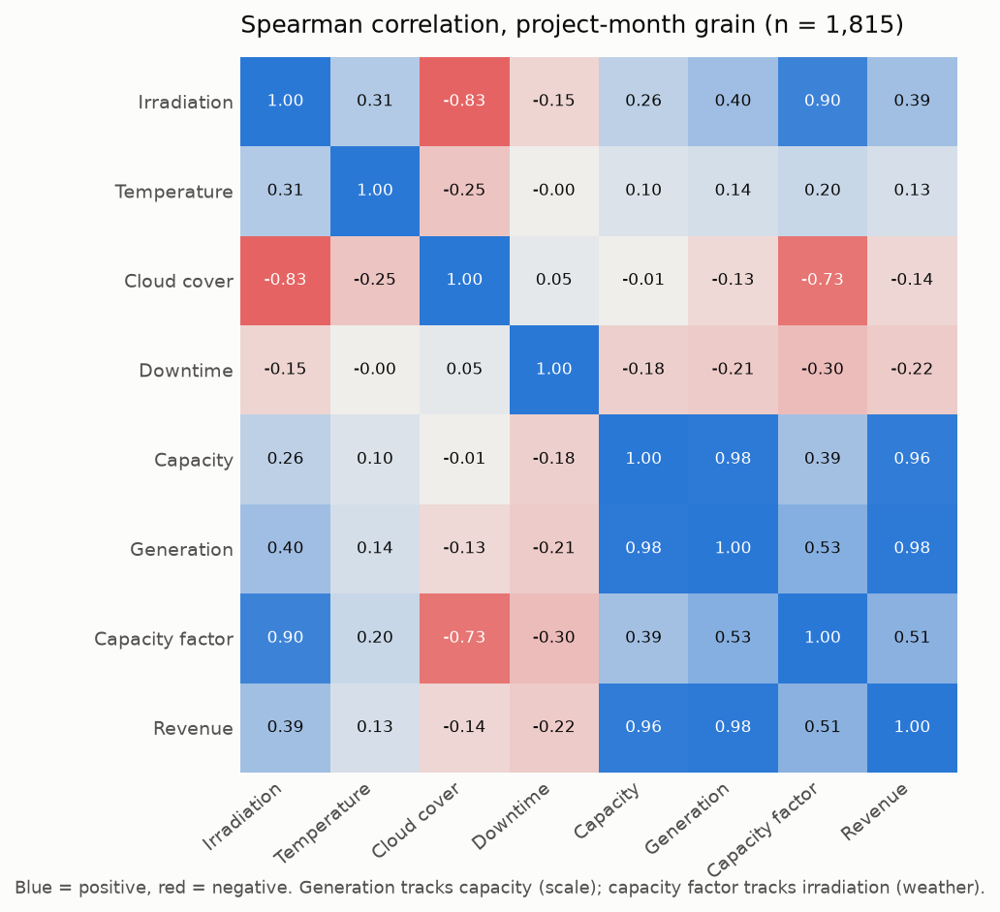
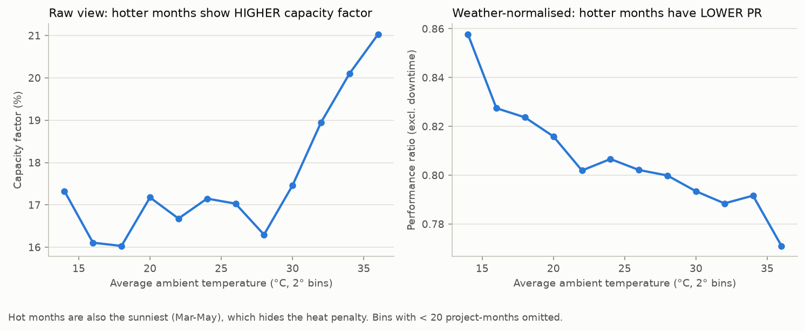
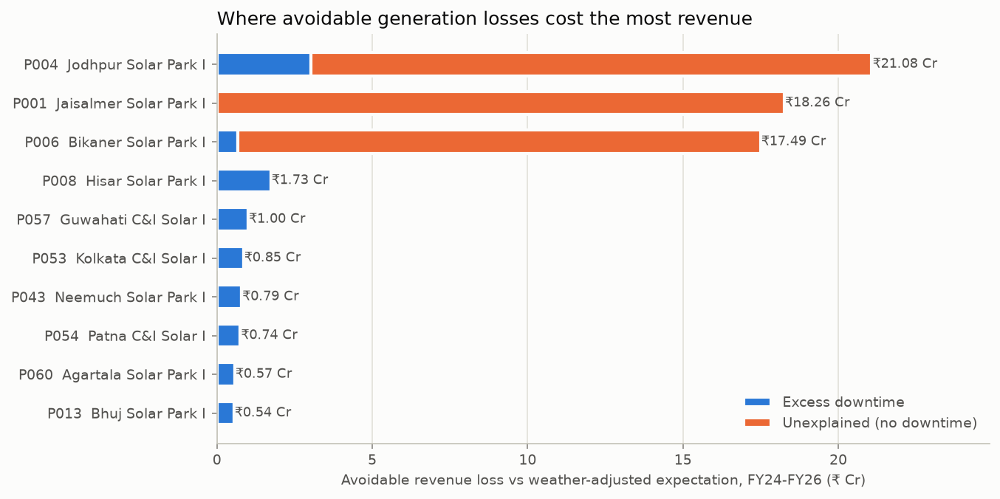
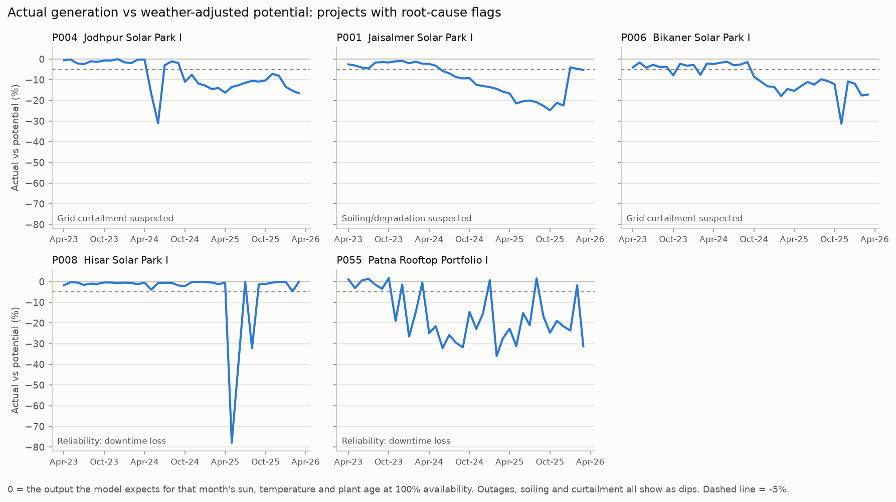
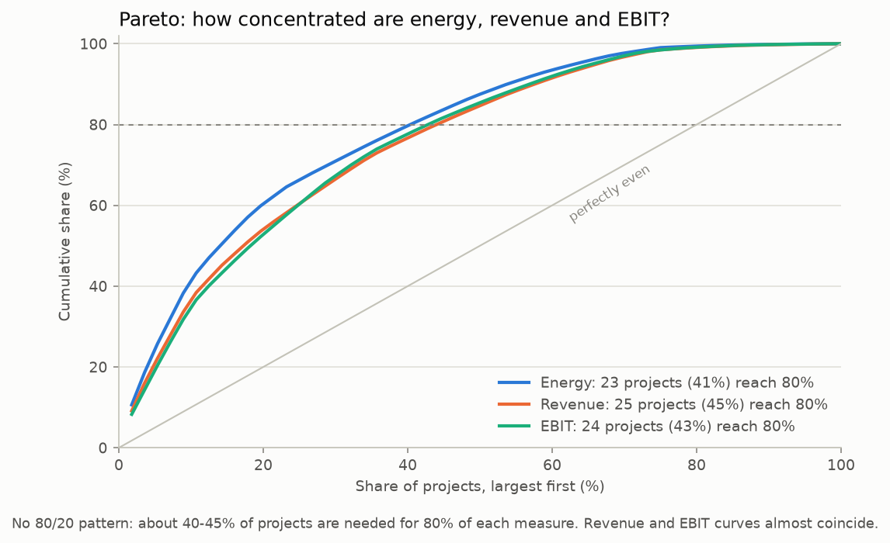

# 03 — Advanced Analytics (Python)

> Stage 3 deliverable. Script: `python/advanced_analytics.py`. It reads the clean MySQL views and writes results back as `ana_*` tables for Power BI, CSVs to `data/processed/` and charts to `reports/figures/`.
> Run order after any rebuild: `sql/run_all.sh` → `python/validate_pipeline.py` → `python/advanced_analytics.py`. The rebuild drops the database, so the `ana_*` tables must be regenerated.

## 1. Correlation analysis

### 1.1 Why two grains

ROI exists only per project, while weather exists only per month. Correlating them on one table would either repeat ROI 36 times, which inflates n and fakes significance, or average away the weather. So the analysis runs at two grains:

| Grain | n | Variables |
|---|---|---|
| Project-month | 1,815 (5 months without weather excluded) | Irradiation, temperature, cloud, downtime, capacity, generation, CF, revenue |
| Project | 56 | Capacity, capex/MW, tariff, CF, PR, availability, O&M/MW, ROI |

**Spearman is the headline measure, with Pearson alongside.** Spearman is rank-based: it is robust to the long right tail of capacity (0.5 to 300 MW) and catches monotonic relationships that are not linear. The two agree on every sign here.



### 1.2 Findings: project-month grain

| Pair | Spearman ρ | What it means |
|---|---|---|
| Capacity ↔ Generation | 0.98 | **Scale, not insight.** Big plants produce more. This is why generation cannot be used to compare plants: use CF or PR |
| Irradiation ↔ Capacity factor | **0.90** | Sunshine is the dominant driver of month-to-month output |
| Cloud cover ↔ Irradiation | −0.83 (r = −0.86 per day) | Cloud is mostly a *proxy* for less irradiation. Putting both in a model would double-count (multicollinearity) |
| Cloud cover ↔ CF | −0.73 | Same effect, seen through the proxy |
| Downtime ↔ CF | −0.30 | Outages matter, but much less than weather month to month |
| Temperature ↔ CF | **+0.20** | **Misleading, see 1.3** |

### 1.3 The temperature trap (confounding)

Physics says heat *reduces* panel output. The raw data says hotter months produce *more*. Both are true:

| Measure | r | p |
|---|---|---|
| Raw correlation, temperature ↔ CF | **+0.205** | < 10⁻¹⁸ |
| Partial correlation, controlling for irradiation | **−0.238** | < 10⁻²⁴ |
| Within-project partial (each plant's own average removed first) | **−0.331** | < 10⁻⁴⁹ |

Hot months (March to May) are also the sunniest. Irradiation is a confounder, and the sign reverses once it is held constant. The within-project version also removes geography and technology, so it is the cleanest estimate.



> **Interview line:** *"A naive analyst would conclude that heat helps. After controlling for irradiation the effect flips negative, and the regression recovers −0.44 % per °C, which matches crystalline-silicon datasheets."*

**Caveat on p-values.** Monthly rows from the same plant are not independent (autocorrelation, repeated measures), so the p-values overstate certainty. The effect sizes and the sign reversal are the evidence; the p-values are not.

### 1.4 Findings: project grain (n = 56). What drives ROI?

| Driver | ρ with ROI | Reading |
|---|---|---|
| **Tariff** | **+0.40** | The strongest single driver of return |
| **Availability** | **+0.36** | Reliability shows up in returns |
| Capacity factor | +0.19 | Weak. Sunshine is **not** what separates good from poor investments |
| Capacity | −0.15 | Bigger is not better on return |
| Capex/MW | −0.07 | Close to zero, because high capex comes **bundled** with high tariffs (ρ = +0.76) |

**The variables move in bundles.** Tariff, capex/MW and O&M/MW are mutually correlated (ρ ≈ 0.75) and all *negatively* correlated with capacity (ρ ≈ −0.8). That is the business model: small C&I and rooftop plants are expensive per MW and earn high tariffs; large utility plants are cheap per MW and earn low tariffs. A bivariate correlation cannot separate these effects, and with n = 56 a multivariate model would be over-fitted. The honest conclusion is that **contract structure (tariff) and reliability explain return better than solar resource does.** This is an association, not a proven cause.

## 2. Expected-generation model

### 2.1 What it answers

*"Given this month's sunshine, temperature and plant age, what should this plant have produced, and where did the rest go?"*

### 2.2 Specification

```
pr_eff = energy / (capacity × irradiation × availability)           # weather- and downtime-normalised
pr_eff ~ technology + (temperature − 25 °C) + plant age + first/second commissioning month
```

- Dividing by availability turns downtime into a **separately measured** loss, instead of leaving it as noise.
- **Trimmed least squares:** fit, drop rows with |robust z| > 3.5, refit. Plants with real problems would otherwise pull the "healthy" benchmark down and hide themselves.
- Pure NumPy `lstsq`, so there are no black-box dependencies and every coefficient can be explained.

### 2.3 Results

| Metric | Value | Sanity check |
|---|---|---|
| R² (fitted rows) | **0.942** | — |
| Residual SD | 1.27 % | A healthy plant is within about ±2.5 % of expectation 95 % of the time |
| Temperature coefficient | **−0.44 % per °C** | Datasheet range for crystalline Si is −0.35 to −0.45 %/°C ✔ |
| Degradation | **−0.70 % per year** | Industry norm is 0.5–0.8 %/yr ✔ |
| Rooftop vs utility PR | −9.1 points | Hotter roofs, less optimal tilt, more shading ✔ |
| First / second operating month | −9.9 / −4.1 points | Commissioning ramp-up ✔ |
| Rows used | 1,758 of 1,815 after trimming | — |

The model recovers physically sensible parameters it was never told. That is the strongest evidence that it is measuring something real.

### 2.4 Loss decomposition

For every project-month:

```
potential   = expected PR × capacity × irradiation            (output at 100% availability)
expected    = potential × availability
downtime loss    = potential − expected
unexplained loss = expected − actual                          (>0: shortfall with NO outage logged)
```

Losses are valued at each project's PPA tariff. **Avoidable** loss counts only downtime *above* the technology median, plus unexplained loss *only* where the unexplained-loss rule fired. Normal downtime and model noise are not "lost revenue".

| | ₹ Cr, FY24–FY26 |
|---|---|
| Avoidable unexplained loss (3 projects) | **53.1** |
| Excess downtime loss (portfolio) | **12.7** |



## 3. Anomaly detection

### 3.1 Approach, and the alternatives considered

| Option | Verdict |
|---|---|
| Classic z-score (mean/SD) | Rejected. The outliers inflate the SD they are measured against (masking) |
| **Robust z-score (median/MAD), threshold 3.5** | **Chosen.** Resistant to the anomalies it hunts; standard threshold (Iglewicz & Hoaglin) |
| Isolation Forest / ML | Rejected for this purpose. It says *that* a point is odd but not *why*. Management needs a cause and an owner, and 56 projects is too few to justify it |
| **Rules on top of robust z** | **Chosen.** Every flag maps to a named root cause and a team that owns it |

**Two detectors, because there are two failure shapes:**

| Detector | Catches | Misses |
|---|---|---|
| Month-level (robust z within the project, plus a materiality floor) | Spikes: hail, outages, repair bills | Persistent losses, which shift the project's own baseline |
| Project-level (latest-FY residual vs portfolio; downtime loss; cost vs peers; capex vs benchmark) | Persistent losses: soiling, curtailment, chronic outages, cost and capital problems | One-off months |

**Materiality floor.** A month is flagged only if it is statistically unusual (|z| > 3.5) **and** practically material: a residual below −5 %, or cost above 2× the project median. Without the floor, new projects with few months (and therefore a tiny MAD) produced 11 false alerts with residuals of only ±2 %.

### 3.2 Root-cause rules

| Signature | Suspected cause | Owner |
|---|---|---|
| Downtime-loss share, robust z > 3.5 | Reliability (inverters, damage) | O&M |
| Latest-FY unexplained loss, robust z < −3.5, **same-state plants with losses starting within 1 month** | Shared external cause: **grid curtailment** suspected | Regulatory / grid |
| Same, **progressive** (losses ≥ 3 pp worse 3–9 months after onset), site-specific | **Soiling / degradation** suspected | O&M / cleaning contract |
| O&M per MW, robust z > 3.5 vs ≥ 5 same-technology peers | O&M cost anomaly (or "driven by downtime" if reliability is also flagged) | Procurement |
| Capex > 115 % of the technology benchmark | Capital overrun | Projects / investment committee |

### 3.3 Results

| Project | Signature | Suspected cause | Onset |
|---|---|---|---|
| P004 Jodhpur Solar Park I | Unexplained −10.9 % in FY26, no downtime | Grid curtailment (shared onset with P006) | Oct-24 |
| P006 Bikaner Solar Park I | Unexplained −12.1 % in FY26, no downtime | Grid curtailment (shared onset with P004) | Oct-24 |
| P001 Jaisalmer Solar Park I | Unexplained −15.1 % in FY26, progressive; **recovers in Jan-26** | Soiling / degradation | Jul-24 |
| P055 Patna Rooftop Portfolio I | Downtime loss **17.9 %** of potential | Reliability (and O&M cost driven by it) | — |
| P008 Hisar Solar Park I | 290 h + 140 h outages with cost spikes in May–Jun-25 | Reliability (one-off event) | — |
| P047 Raipur C&I Solar I | Normal PR and availability; O&M z = 3.8 vs peers | O&M cost anomaly | — |
| P039 Kochi Floating Solar I | Capex 130 % of benchmark | Capital overrun | — |
| P057 Guwahati C&I Solar I | Capex 118 % of benchmark | Capital: North-East logistics premium | — |



**A finding that links cost and performance.** P001's maintenance spend fell from ₹5.62 Cr in FY24 to ₹4.10 Cr in FY25 while its cleaning contract had lapsed. Over the same period the model attributes **₹18.3 Cr** of lost revenue to the progressive loss. That is roughly ₹2–3 Cr saved against ₹18 Cr lost. (The cause is labelled "suspected" until a site visit confirms soiling.)

## 4. Pareto and ABC

| Measure | Projects for 80 % | Top-10 share |
|---|---|---|
| Energy | 23 of 56 (41 %) | 57.1 % |
| Revenue | 25 of 56 (45 %) | 51.0 % |
| EBIT | 24 of 56 (43 %) | 49.4 % |

**There is no 80/20 pattern.** The portfolio is moderately concentrated: a single-asset failure is not existential, but the top 10 still carry about half of revenue.



ABC on revenue (class set by the cumulative share *before* each project, so the project that crosses 80 % is still an A):

| Class | Projects | Revenue share | Capex (₹ Cr) | Median ROI | Utility-scale |
|---|---|---|---|---|---|
| A | 25 | 80.5 % | 8,291 | 5.86 % | 17 |
| B | 13 | 15.3 % | 1,682 | 5.59 % | 5 |
| C | 18 | 4.2 % | 767 | **6.90 %** | 2 |

**Revenue concentration is not return.** C-class projects are small and contribute 4 % of revenue, but earn the highest median ROI. A-class projects carry the portfolio's volume at average returns. ABC answers "where to focus operations"; it does not answer "where to invest".

## 5. Outputs for Power BI

| Table | Grain | Used on |
|---|---|---|
| `ana_month_diagnostics` | Project × month | Page 4: expected vs actual, loss decomposition, month flags |
| `ana_project_diagnostics` | Project | Page 4: root-cause table; Page 6: risk indicators |
| `ana_project_segments` | Project | ABC and Pareto visuals |

Python's recomputed portfolio ROI (5.8338 %) and CF (0.181341) match the SQL views.

## 6. Evaluation against the planted ground truth

The analysis never reads `data/ground_truth/`. A separate evaluation function does, at the end.

| Version | Root causes correct | False positives | Notes |
|---|---|---|---|
| v1 | 5 / 7 | 1 (P057) | Both curtailment plants labelled "soiling" |
| **v2 (final)** | **7 / 7** | **1 (P057)** | After the 2 fixes below |

**What changed between v1 and v2, disclosed in full:**

1. **Bug fix, independent of the evaluation.** The ramp-up dummy counted months from the *window start*, not from commissioning, so every pre-FY24 plant had a false "first month" in Apr-23. After the fix, the ramp coefficients are −9.9 / −4.1 points (truth: about −12 / −5).
2. **Rule revision, made after seeing the evaluation.** v1 checked loss *shape* before *regional co-onset*. Curtailment carries a seasonal swing (larger in sunny months) that looks "progressive", so it was mislabelled. Losses starting in the same month at separate plants are independent, cross-site evidence. Checking that first is the principled order, but because the change was made after evaluation, there is a **risk of over-fitting to this dataset**. On new data the rule should be re-validated.
3. Onset is now the first month that is itself below −5 % inside the triggering 3-month window. The forward window had been firing up to 2 months early.

**Quantification accuracy (hidden losses known only to the generator):**

| Scenario | Model estimate | True loss | Error |
|---|---|---|---|
| Curtailment (2 plants) | 131,085 MWh | 125,825 MWh | +4.2 % |
| Soiling | 68,912 MWh | 64,764 MWh | +6.4 % |

The slight over-estimate is expected: degradation and noise on these plants are absorbed into "unexplained".

**The remaining false positive, P057,** is not noise. The North-East capex premium is real in the data (+12 % logistics). It is a correct flag of a structural issue, not a planted one.

## 7. Limitations

- Synthetic data. Real SCADA has sensor drift, clipping and partial-month outages that this data does not.
- Irradiation is GHI, not plane-of-array. Tilt and tracking differences are absorbed by the technology term.
- Curtailment versus soiling is **inferred** from signatures. Confirmation needs grid-operator curtailment logs and site inspection.
- n = 56 at project grain is too small for multivariate inference about ROI drivers.
- Thresholds (3.5, −5 %, 115 %) are conventions. They are documented as constants so they can be tuned openly.
