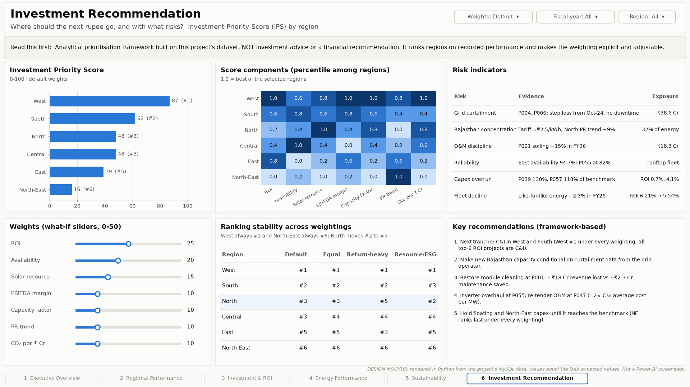

# 03 — Dashboard Design & Build Guide

> **About the images below.** Power BI Desktop is Windows-only and this project was developed on Linux, so these are **design mockups rendered in Python** (`python/render_dashboard_mockups.py`) from the same MySQL data. Every number equals the DAX expected value. They are the specification to build against. They are **not Power BI screenshots**, and each image says so. Real screenshots go in `screenshots/` once the `.pbix` is built.

## Design system

| Element | Rule |
|---|---|
| Canvas | 16:9, 1920 × 1080; page background `#f9f9f7`, visual background `#fcfcfb`, 1 px border `#e1e0d9` |
| Layout | Header (title + business question) → slicer row → KPI cards → 2 rows of visuals → page tabs |
| Colour | Single-series = blue `#2a78d6`. The only second colour is orange `#eb6834`, used for "below portfolio" / "loss". Sequential blue for magnitude (maps, matrices). Colour never carries meaning alone: labels always do too |
| Charts | No dual axes, no pie charts, no 3-D. Trend = line, ranking = sorted bar, relationship = scatter, composition = stacked bar |
| Text | Every page title is the question it answers. KPI cards carry a context line (YoY, margin or definition) |
| Slicers | Fiscal year, Region, Project type, synced across pages 1–5. Page 6 adds weight sliders |
| Accessibility | Values labelled directly on bars; every visual has alt text; tab order set (View › Selection) |

## Page 1 — Executive Overview

**Question:** *Is the portfolio healthy, and where should management look first?*

| Visual | Fields / measures |
|---|---|
| 6 KPI cards | `Energy (GWh)`, `Total Investment (₹ Cr)`, `Revenue (₹ Cr)`, `EBIT (₹ Cr)`, `ROI %`, `CO2 Avoided (Mt)`; context lines `Energy YoY %`, `LFL Energy YoY %`, `EBITDA Margin %`, `Equivalent Households` |
| Headline banner | Card (new) with `Headline Volume vs Return` |
| Energy trend | Line: `'Date'[MonthStart]` × `Energy (GWh)` |
| Revenue trend | Line: `'Date'[MonthStart]` × `Revenue (₹ Cr)`. A **separate chart**, not a second axis |
| Map | Map visual: Project[latitude], [longitude], size `Energy (GWh)`, tooltip `ROI %` |
| Regional performance | Clustered bar: region × `ROI %`, data labels plus `Contribution % (Energy)` in the tooltip |
| Investment vs ROI | Scatter: Project Label (details), x `Total Investment (₹ Cr)` (log), y `ROI %`; constant line at portfolio ROI |
| Top 10 projects | Table filtered by `Is In Top N (ROI)` = 1, sorted by `ROI %` |
| Management summary | Text box (Stage 5 insights) |

## Page 2 — Regional Performance

**Question:** *Which regions perform best, on volume vs efficiency?*

| Visual | Fields / measures |
|---|---|
| Ranking matrix | Rows: hierarchy region › state › city › Project Label (**drill-down enabled**); values `Energy (GWh)`, `Contribution % (Energy)`, `Capacity Factor`, `Performance Ratio`, `Realised Tariff`, `ROI %`, `Region Rank (Energy)`, `Region Rank (ROI)` |
| Filled map | Map by city coloured by `ROI %` (gradient), size `Energy (GWh)`. Filled (shape) map for state shapes if the tenant allows it |
| Energy share and ROI | Two bar charts with the same sort order, side by side. Small multiples, not two axes |
| CF vs ROI | Scatter by region, size = energy, label = realised tariff |
| ROI trend | Matrix region × `'Date'[FiscalYear]` with `ROI %`, background gradient |

## Page 3 — Investment & ROI

**Question:** *Which projects earn their capital, and why?*

| Visual | Fields / measures |
|---|---|
| Quadrant scatter | x `Total Investment (₹ Cr)` (log), y `ROI %`, legend `Project[Investment Quadrant]`; X/Y constant lines at the median investment and portfolio ROI |
| ROI ranking | Bar: Project Label × `ROI %`, `Top N` slicer, font colour `ROI vs Portfolio Colour` |
| Revenue → profit waterfall | Waterfall from a 5-row disconnected "P&L Step" table plus a `SWITCH` measure (Revenue, −Opex, −Maintenance, −Depreciation, EBIT) |
| Profitability matrix | Matrix: project_type × `Capex/MW`, `Realised Tariff`, `Capacity Factor`, `EBITDA Margin %`, `ROI %` |
| Quadrant summary | Table: Investment Quadrant × project count, `Total Investment (₹ Cr)`, median ROI, plus a text column with the action |

How to read each quadrant: [04_scoring_methodology.md §4](04_scoring_methodology.md#4-investment-quadrant-project-level-page-3).

## Page 4 — Energy Performance

**Question:** *Is underperformance caused by weather or by operations?*

| Visual | Fields / measures |
|---|---|
| KPI cards | `Energy (GWh)`, `Capacity Factor`, `Performance Ratio`, `Availability`, `Actual vs Potential %`, `Avoidable Loss (₹ Cr)` |
| Monthly generation, CF trend | Column chart and a separate line chart |
| Generation vs irradiation | Scatter on Energy rows: daily irradiation vs capacity factor; P001/P004/P006 highlighted |
| Generation vs capacity | Scatter by project, log-log, with an 18 % CF reference line |
| Avoidable loss | Stacked bar from Project[excess downtime] and [avoidable unexplained] |
| Root-cause table | Project[suspected_root_cause], [latest_fy_residual_pct], [loss_onset], `Avoidable Loss (₹ Cr)`; **drill-through** to a project detail page |

## Page 5 — Sustainability

**Question:** *What is our environmental impact, in total and per rupee?*

| Visual | Fields / measures |
|---|---|
| KPI cards | `CO2 Avoided (Mt)`, `CO2 per MW-Year`, `CO2 per ₹ Cr-Year`, `Equivalent Households`, `Renewable Share (Captive) %` |
| Sustainability Score | Bar: region × `Sustainability Score` |
| CO₂ by region | Bar with data labels and `Contribution %` |
| Impact efficiency | Scatter by region: `CO2 per MW-Year` vs `CO2 per ₹ Cr-Year` |
| Monthly CO₂ | Line |
| Method | Text box with the formula. **A score must show its own formula** |

## Page 6 — Investment Recommendation

**Question:** *Where should the next rupee go, and with what risks?*

| Visual | Fields / measures |
|---|---|
| Disclaimer banner | Static text: analytical framework, not investment advice |
| IPS bar | region × `Investment Priority Score`, label `Investment Priority Rank` |
| Weight sliders | 7 what-if parameters (single-value slicers) |
| Component heatmap | Matrix: region × the 7 `Pctl …` measures, background gradient |
| Ranking stability | Table from `Region Scores` (Python reference ranks under 4 weightings) |
| Risk indicators | Table (Stage 5 insights, data-backed) |
| Recommendations | Text box |

## Extra pages (recommended)

- **Project Detail (drill-through):** right-click any project → monthly actual vs expected, loss decomposition, month flags, P&L.
- **Data Quality (appendix):** `DQ Summary` table plus a count of reconstructed and imputed months. It shows reviewers that the numbers are trustworthy.

---

## Build guide (Windows, Power BI Desktop)

1. **Prepare MySQL:** run `sql/run_all.sh` → `python/validate_pipeline.py` (41/41) → `python/advanced_analytics.py` → `python/scoring_and_expected_values.py`. Install **MySQL Connector/NET** on the Windows machine.
2. **Power Query:** create the parameters `MySqlServer` and `MySqlDatabase`, then paste each query from [`powerquery/queries.m`](../powerquery/queries.m). Disable load on `fnGetTable`, `Validation` and `Audit - Diagnostics Errors`. Turn off Auto date/time.
3. **Refresh**, then open the `Validation` query: every row must say PASS.
4. **Model:** create the 8 relationships in [01_data_model.md](01_data_model.md) (all single-direction, many-to-one). Mark `Date` as the date table. Set sort-by columns, the hierarchy and data categories. Hide keys.
5. **Measures:** create a `_Measures` table (Enter data, one blank column, then delete the column). Paste the measures from [`dax/measures.dax`](../dax/measures.dax) folder by folder and set the display folders and format strings in the comments. Add the calculated column `Investment Quadrant` to Project.
6. **What-if parameters:** `Top N` (5–20, step 5, default 10) and the 7 weights (0–50, step 5, defaults 25/10/10/15/10/10/20).
7. **Validate measures:** build one table visual with every measure and no filters, then compare it with [05_dax_expected_values.md](05_dax_expected_values.md) §A. Repeat with FY2025-26 and with Region = West (§C). Then compare the IPS and ranks by region (§E).
8. **Pages:** build pages 1–6 from the specs and mockups above. Apply the design system through View › Themes › Customize (colours `#2a78d6`, `#eb6834`).
9. **Screenshots:** export each page (File › Export › PDF, or a screenshot) into `screenshots/`, then replace the mockup references in the README.
10. **Publish (optional):** publish to the Power BI Service. For scheduled refresh from MySQL, install an on-premises data gateway.
